## Pacientes 

## Tabla original de pacientes
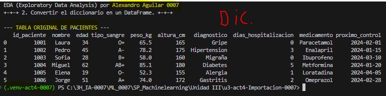
## Convertir el diccionario en Dataframe
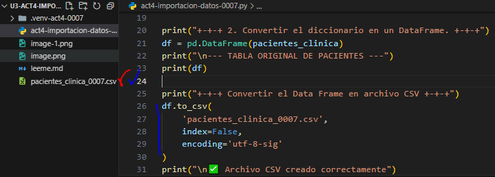
## Datos del CSV --> Base de datos
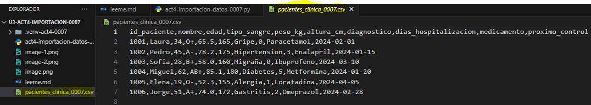
## Leer los datos desde el archivo CSV
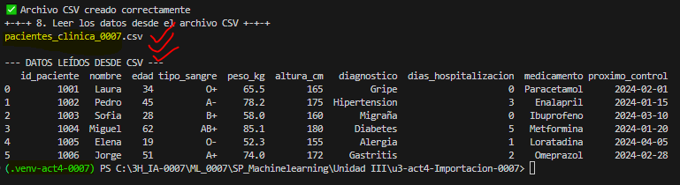
## Primeros y ULtimos registros
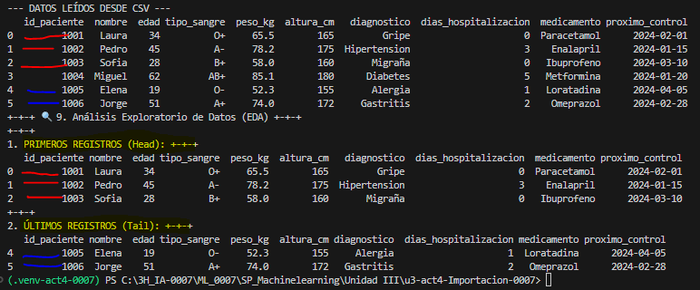
## Dimensiones y estructuras
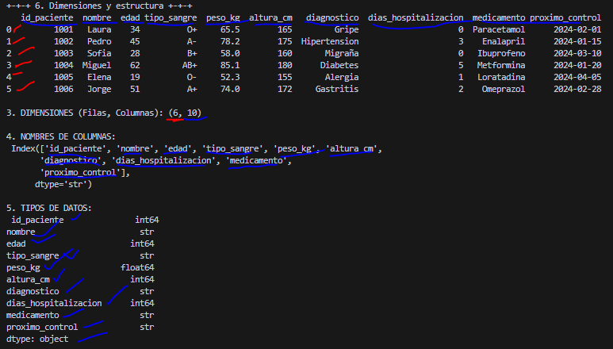
## Estadisticas y limpieza
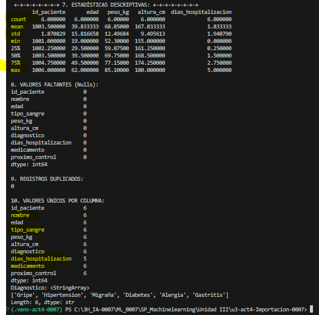
## Análisis específico y Ordenamiento, filtrado y agrupación
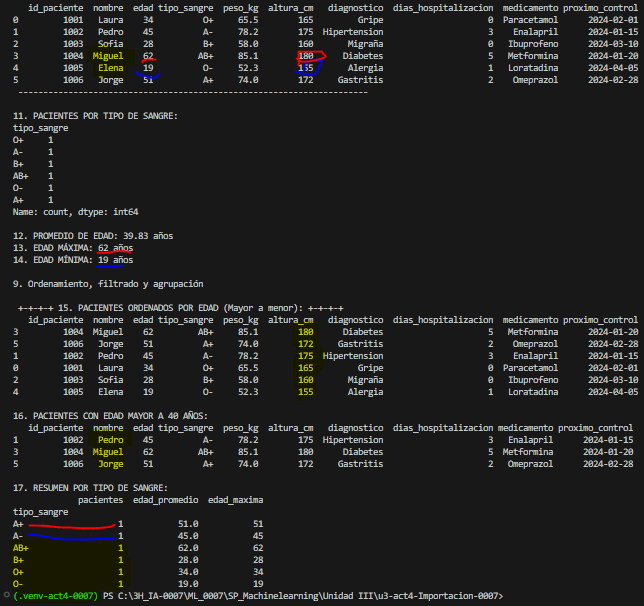
## Grafica de barras: tipo de sangre
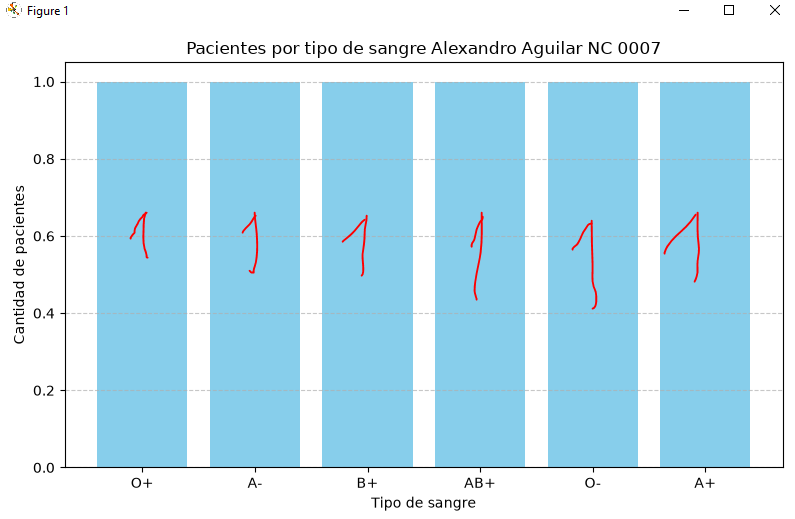
## Grafica de barras: peso por paciente
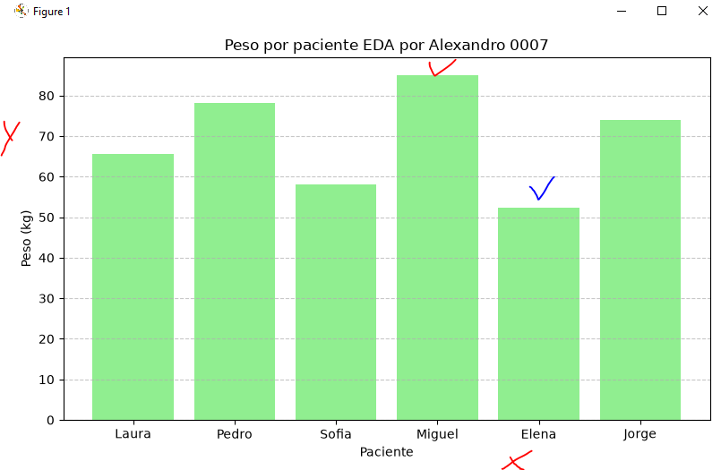
## Grafica de barras: Distribucion por edad de pacientes
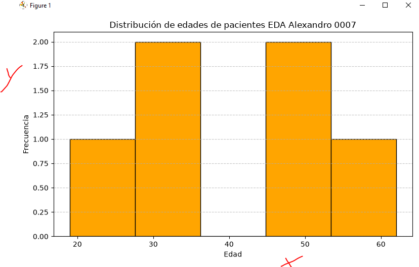
## Grafica de dispersion: relacion entre peso y edad
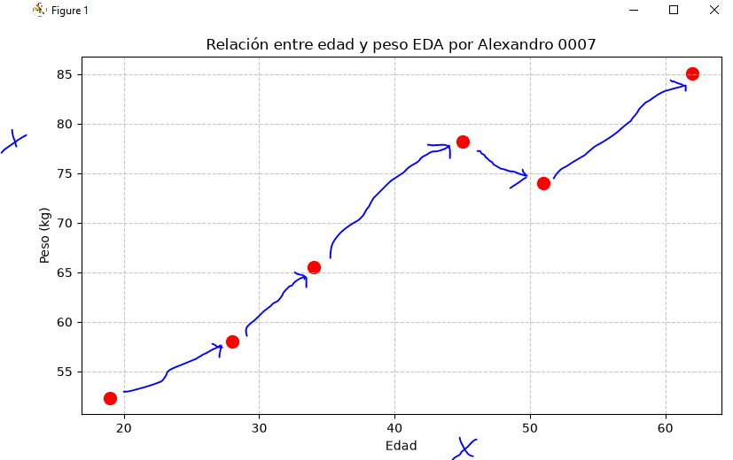
## Diagrama de caja: Distribucion de pesos
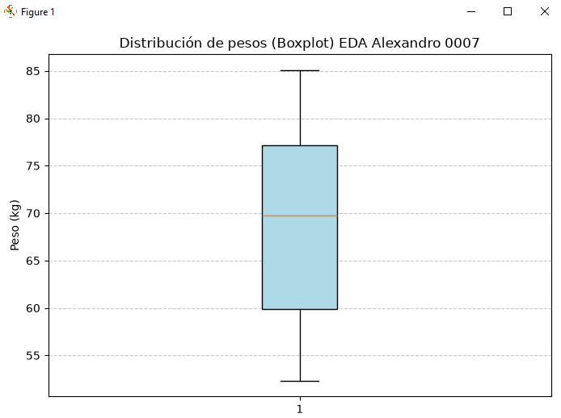
## Matriz de correlacion
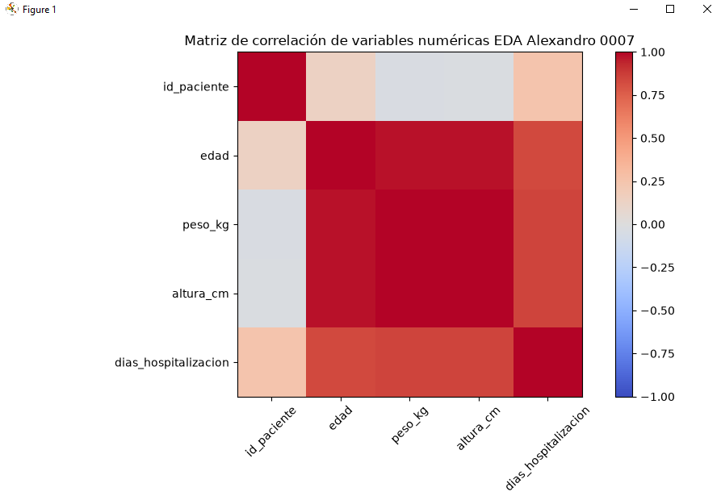